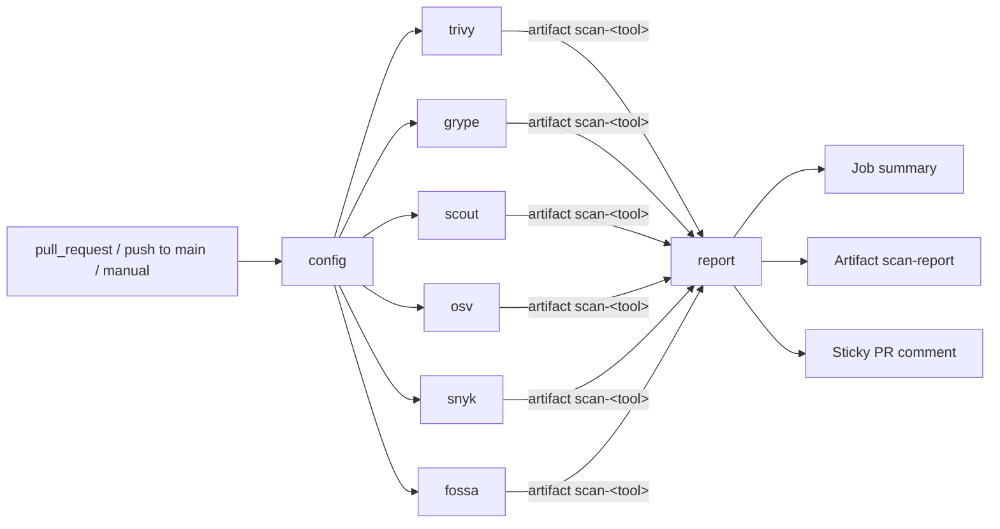

# container-scanner-comparison

Are you scanning container images from GitHub Actions? If so, this repo might be interesting
for you. I was looking for a replacement for Trivy to scan our images, and got Claude to generate
workflows to test each of the tools I knew about, and finally, compare the findings.

The repo has two goals:

1. **Compare scanners.** Every tool scans the same image and one report shows how their
   findings overlap and differ. The default is [OWASP Juice Shop](https://owasp.org/www-project-juice-shop/)
   (`bkimminich/juice-shop:v20.3.0`). It is actively maintained and built on a supported OS
   (`distroless/nodejs24-debian13`), and it deliberately ships outdated npm dependencies such as
   `jsonwebtoken 0.4.0`, `express-jwt 0.1.3` and `sanitize-html 1.4.2`. So it exercises both OS
   and language-package scanning. Use the `image` input or the `SCAN_IMAGE` variable to scan
   something else.
2. **Workflow samples.** Each tool has its own self-contained workflow using the vendor's
   premade GitHub Action where one exists.

## Tools

| Tool | Workflow | Action used | Account / secret | Raw output |
|---|---|---|---|---|
| [Trivy](https://trivy.dev) | [`scan-trivy.yml`](.github/workflows/scan-trivy.yml) | `aquasecurity/trivy-action` | none | JSON |
| [Grype](https://github.com/anchore/grype) | [`scan-grype.yml`](.github/workflows/scan-grype.yml) | `anchore/scan-action` | none | JSON |
| [Docker Scout](https://docs.docker.com/scout/) | [`scan-docker-scout.yml`](.github/workflows/scan-docker-scout.yml) | `docker/login-action` + `docker/scout-action` | free Docker Hub account: `DOCKERHUB_USERNAME`, `DOCKERHUB_TOKEN` | SARIF |
| [OSV-Scanner](https://google.github.io/osv-scanner/) | [`scan-osv.yml`](.github/workflows/scan-osv.yml) | `google/osv-scanner-action/osv-scanner-action` | none | JSON |
| [Snyk Container](https://snyk.io/product/container-vulnerability-management/) | [`scan-snyk.yml`](.github/workflows/scan-snyk.yml) | `snyk/actions/docker` | Snyk account (free plan has a monthly test quota): `SNYK_TOKEN` | JSON |
| [FOSSA](https://fossa.com) | [`scan-fossa.yml`](.github/workflows/scan-fossa.yml) | `fossas/fossa-action` + `fossa container test` | FOSSA account: `FOSSA_API_KEY` (full key, not push-only) | JSON |

Tools whose secrets are missing don't fail: their job shows a notice, and the report lists them as **skipped**.

### Tools considered but not included

- **Checkov** can only scan image packages for CVEs with a Prisma Cloud API key
  (`checkov --docker-image`). Without one, it only lints Dockerfiles for misconfigurations,
  which is a different job from vulnerability scanning.
- **Qualys QScanner** needs a paid Qualys Container Security subscription; Community Edition
  doesn't include it. Qualys also has no official GitHub Action. The Marketplace "Qualys
  Container Scan" action is an unofficial personal project, and we don't hand it a Qualys token.
- **Clair v4** looks abandoned for CLI and CI/CD use. [`quay/clair-action`](https://github.com/quay/clair-action)
  was archived in July 2026, and its vulnerability database is no longer hosted, so every run
  would have to build one first. Clair itself is still maintained as the scanner behind Quay
  registries, but you run it as a service there, not as a CI step.

### Caveats per tool

- **Trivy:** `aquasecurity/trivy-action` tags were hijacked in a 2026 supply-chain attack.
  Only ever reference it by commit SHA.
- **Docker Scout:** `write-comment: false` stops Scout from posting its own PR comment, since
  the aggregate job takes care of the comment. Scout still writes its own job summary.
- **OSV-Scanner:** the action runs in its own container without a Docker daemon, so the
  workflow passes it the image as a `docker save` archive (`--archive`).
- **Snyk:** `snyk/actions` has no maintained release tags, so the workflow pins a commit on
  `master`. The action's runtime image `snyk/snyk:docker` is a moving tag.
  Snyk lists each issue once per dependency path. The report counts (CVE, package) pairs
  instead, the same way as Trivy and Grype. Snyk bases OS severities on the distribution's
  own assessment, which can be lower than NVD's (`nvdSeverity` in `snyk.json`).
- **FOSSA:** `container analyze` uploads the image's dependency list to FOSSA, and
  `container test` then fetches the issues back as JSON.

## How workflows and jobs fits together



- [`container-scan.yml`](.github/workflows/container-scan.yml) is the entry point. It calls each
  `scan-*.yml` as a reusable workflow, in parallel, and passes each one only the secrets it needs.
- Each `scan-*.yml` can also be started on its own from the Actions tab (`workflow_dispatch`).
  It uploads the raw tool output plus a `meta.json` (`status`, `version`, `reason`) as the
  artifact `scan-<tool>`.
- The **report** job runs even if some scanners failed. It downloads every `scan-*` artifact and
  runs [`scripts/aggregate.sh`](scripts/aggregate.sh), which uses Bash + `jq` only. It then:
  - appends `report.md` to the run's **job summary**
  - uploads `scan-report`: `report.md`, `report-comment.md`, `findings.json` and `findings.csv`
  - on pull requests, creates or updates one **PR comment** (`marocchino/sticky-pull-request-comment`)
  - optionally fails the run as a severity gate

### The report

- **Results per tool:** status, tool version and unique vulnerabilities per severity, plus how
  many have a fix available.
- **Agreement between tools:**
  - how many vulnerabilities were found by 1, 2, … N tools
  - a pairwise overlap matrix
  - per tool, the number of findings only it reported and the number it missed that every
    other tool found
  - how many vulnerabilities the tools rated with different severities
- **Critical and High vulnerabilities:** the top 50, with a ✓ for each tool that found them.
- **Details per tool:** collapsible sections, in the job summary only.

How findings are normalized:
- Findings are compared on the **CVE id**. GHSA, DSA, Snyk and OSV ids are resolved to CVEs
  through each tool's aliases or related-vulnerability data where possible. Advisories
  without a CVE are compared on their GHSA id.
- Package names follow Trivy and Grype: the binary package for OS packages (`libc6`, not
  `glibc/libc6`), and the full name for scoped npm packages and Go modules (`@babel/core`).
- Severities are mapped to Critical / High / Medium / Low / Unknown. Debian "negligible"
  counts as Low, and CVSS scores are bucketed.

### Configuration

| Where | Name | Purpose |
|---|---|---|
| Manual run input / repo variable `SCAN_IMAGE` | `image` | Image to scan (default `bkimminich/juice-shop:v20.3.0`) |
| Manual run input / repo variable `SCAN_FAIL_ON` | `fail-on` | `none` (default), `critical`, `high`, `medium` or `low`, in any case. Fails the run *after* the report is published |
| Repo secrets | see the tools table | Enable the account-based tools |

A manual run uses the repository variables unless you fill in `image` or pick a `fail-on`
value other than `default`. An invalid `fail-on` value stops the run in the Configure job,
before any scanner runs.

The severity gate also fails when a scanner failed or left no artifact, because a scan that
didn't run found nothing. Tools that are skipped because their secrets aren't set don't count.

## Quality checks

These workflows run on pushes that touch the relevant files:

| Workflow | What it checks |
|---|---|
| [`actionlint.yml`](.github/workflows/actionlint.yml) | Workflow syntax and expressions, plus ShellCheck on `run:` blocks |
| [`zizmor.yml`](.github/workflows/zizmor.yml) | Workflow security: injection, permissions, credentials, pinning. Configured in [`.github/zizmor.yml`](.github/zizmor.yml) |
| [`shell.yml`](.github/workflows/shell.yml) | ShellCheck and shfmt on all `*.sh` files, and the aggregator regression tests |

- **Shell formatting** follows [Google's shell style guide](https://google.github.io/styleguide/shellguide.html).
  [`.editorconfig`](.editorconfig) sets the shfmt options (equivalent to `shfmt -i 2 -ci -bn`).
  Run `shfmt -w .` to fix formatting locally.
- **Aggregator tests:** [`tests/run.sh`](tests/run.sh) runs `scripts/aggregate.sh` on each
  `tests/cases/*/input/` and diffs the result against `expected/`. The `juice-shop` and
  `statuses` inputs are trimmed copies of real scanner output, covering each tool's quirks and
  the failed, skipped and missing states. `normalization` is a small hand-written case for
  matching across tools: GHSA-only advisories, scoped and percent-encoded package names, OSV fix
  versions per distro release and version range, and Snyk license issues.
  After an intended change to the report, run `tests/run.sh --update` and review the diff of
  `expected/` before committing. The script needs jq 1.7 or later.

## Local debugging with act

[`act`](https://github.com/nektos/act) runs the workflows in Docker on your machine. The
[`.actrc`](.actrc) in this repo sets:
- the runner image
- a local artifact server, so jobs can pass artifacts
- `.secrets` as the secrets file

```bash
cp .secrets.example .secrets            # fill in what you have; empty = tool skipped

# One tool
act workflow_dispatch -W .github/workflows/scan-trivy.yml --input image=bkimminich/juice-shop:v20.3.0

# The whole pipeline (scans + report); the PR comment step is skipped outside pull_request
act workflow_dispatch -W .github/workflows/container-scan.yml

# Re-render the report from a previous run's artifacts
gh run download <run-id> --pattern 'scan-*' --dir artifacts
scripts/aggregate.sh --in artifacts --out report --image bkimminich/juice-shop:v20.3.0
```

Limitations of `act`:
- Support for reusable workflows (`workflow_call`) is partial, so if the orchestrator
  misbehaves, run the per-tool workflows one at a time.
- Docker container actions (OSV-Scanner, Snyk) need access to the Docker socket, which
  `act` provides by default.
- `GITHUB_STEP_SUMMARY` output is written to a temp file, not rendered.
